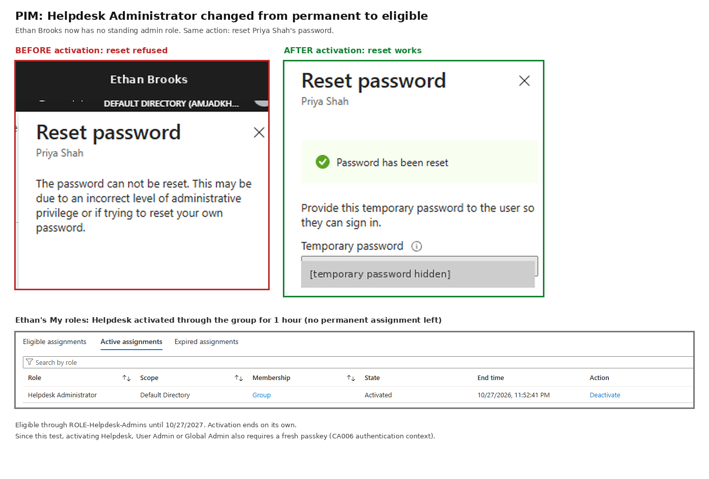
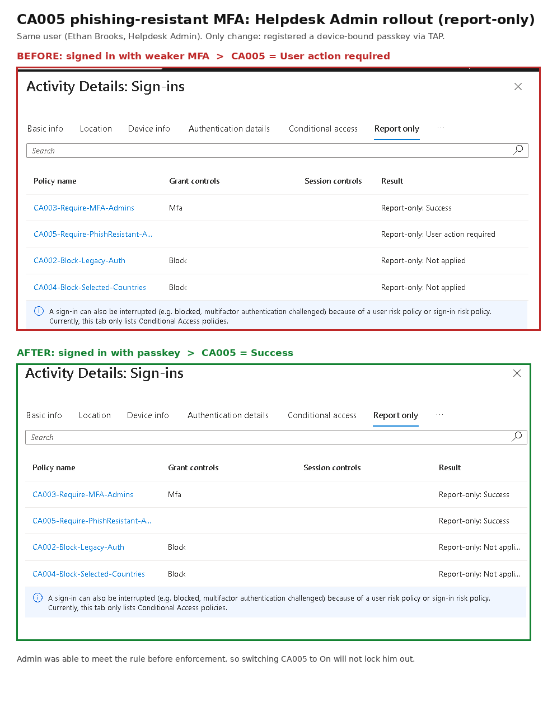
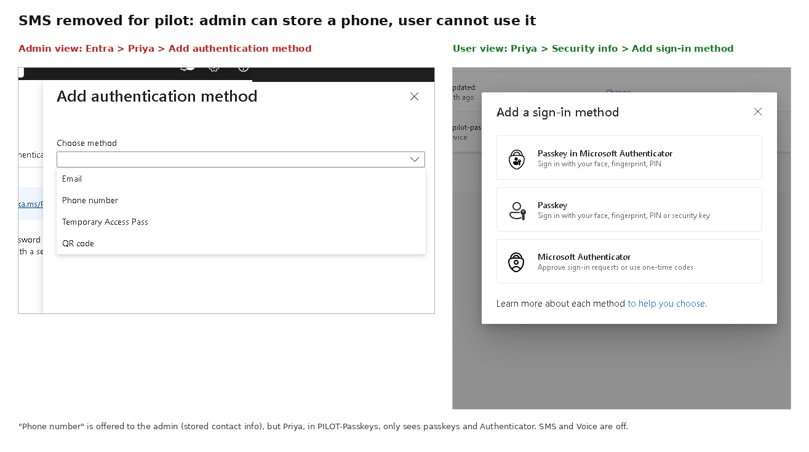
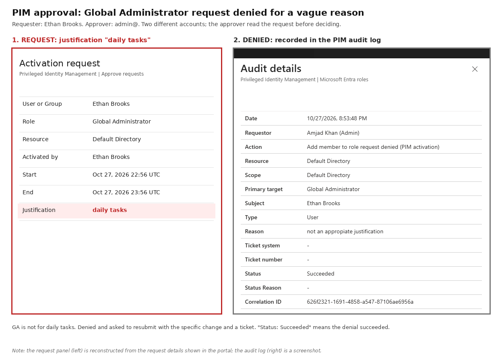
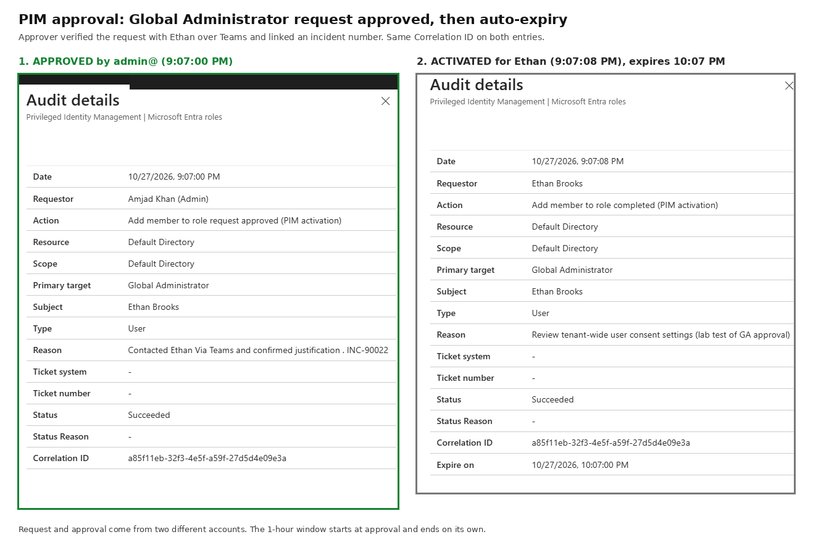
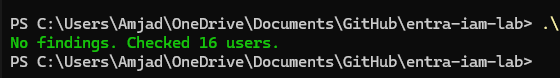

# Hands-on Microsoft Entra ID lab: Conditional Access, passkeys, PIM, access reviews and PowerShell/Graph automation

I work in IT support and handle joiner/mover/leaver requests in Adaxes at my job. I built this lab to practice the parts of IAM I don't get to do much at work, mainly access reviews, finding access problems, and automating the user lifecycle.

Everything here runs against my own test tenant with fake users. Nothing touches a real company environment.

I used AI to help write the scripts. My part was designing how they should work, testing them, fixing what broke, and going through the code line by line so I can explain and change it. Some of the changes and bug fixes below are my own.

## Highlights

- **Conditional Access:** replaced security defaults with 6 policies (MFA for everyone, legacy auth block, country block, phishing-resistant MFA for admins, and a fresh passkey to activate admin roles). Every policy ran in report-only and was tested with What If before being turned on. Design and test results: [CA_Policy_Design.md](CA_Policy_Design.md)
- **Passkeys:** piloted passkeys with passwordless onboarding (Temporary Access Pass, then a device-bound passkey, then the pass is deleted). Testing showed admins could still register a phone for password reset even with SMS turned off.
- **PIM:** no account has standing User Admin, Helpdesk or Global Admin except my daily admin and the break-glass account. Global Admin needs a second person to approve, and activating any of the three roles needs a fresh passkey.
- **Found a real risk:** testing a policy showed a personal Microsoft account still held Global Administrator, and the tenant couldn't see how it did MFA. Removed the role and kept the audit log as evidence.
- **PowerShell and Microsoft Graph:** scripts that export user access, flag access risks (disabled users with access, wrong department, segregation of duties, missing data) and handle joiners, movers and leavers from an HR feed with a preview mode and a log.
- **Access reviews:** quarterly review where each person's manager reviews them and a fallback reviewer covers the manager, so nobody reviews their own access. Together with my scripts, it took the access-risk findings to 0.



## The lab setup

- 12 test users across Finance, Sales, and IT (10 to start, plus Kevin and José who were created by the JML script), one service account (svc-backup), and my admin account
- 5 assigned security groups for access: Finance-Share, Sales-Share, IT-Admins, AP-Vendor-Create, AP-Payment-Approve
- DYN-Finance-Users: a dynamic security group with the rule (user.department -eq "Finance") -and (user.accountEnabled -eq true)
- ROLE-Helpdesk-Admins: a role-assignable security group holding the Helpdesk Administrator role, with Ethan Brooks as its member
- Finance Team: a Microsoft 365 group (shared mailbox, calendar and SharePoint site) owned by Daniel Kim
- Microsoft 365 E5 trial (includes Entra ID P2) with recurring billing off, licenses assigned to my admin and 10 active test users
- Managers and group owners set so there's someone to approve access (Daniel Kim for Finance, Marcus Reed for Sales)
- A few problems set up on purpose so the scripts have something to find
- Three apps in Entra for the permissions and SSO labs: Lab-App-01 (an app I registered), Microsoft Entra SAML Toolkit (a gallery app set up for SAML SSO), and Microsoft Graph Command Line Tools (what my PowerShell scripts sign in through)
- Two admin accounts: a native cloud-only admin (admin@<tenant>.onmicrosoft.com) with passkeys that I use for all lab work, and a break-glass account. My original account (the personal Microsoft account that created the tenant) no longer has any Entra role
- Conditional Access policies CA001 to CA006 and passkeys rolled out to a pilot group (see Conditional Access and authentication below)
- PIM for User Administrator, Helpdesk Administrator and Global Administrator; Ethan Brooks has no standing admin roles (see Privileged Identity Management below)
- An Azure subscription with a $5 monthly budget alert, a resource group (rg-iam-lab), and a user-assigned managed identity (mi-jml-automation) that has no permissions yet

## Admin accounts

| Account | Purpose | Type | Roles | MFA | Notes |
|---|---|---|---|---|---|
| admin@<tenant>.onmicrosoft.com | Daily lab administration | Internal, cloud-only Member | Global Administrator; Azure Owner on the subscription with a condition (can't assign Owner, User Access Administrator or RBAC Administrator) | Microsoft Authenticator push, device-bound passkey in Authenticator, synced passkey in my password manager | Department IT, usage location US, E5 license, in PILOT-Passkeys |
| bg-emergency01@<tenant>.onmicrosoft.com | Break-glass, emergency use only | Internal, cloud-only Member | Global Administrator, permanently active (not PIM eligible) | Microsoft Authenticator | 32-character random password in my password manager, no license, signed in once to register MFA and verify |
| Original account (personal Microsoft account) | Azure subscription owner | External identity, Member | No Entra roles (Global Administrator removed in Step 4); Azure subscription Owner | Its own Microsoft account sign-in, outside my tenant's control | Not used for lab work. The E5 trial was bought with admin@, and personal accounts can't sign in to the Microsoft 365 admin center anyway |

Global Administrator is now exactly 2 native accounts: admin@ and the break-glass account.

Break-glass rules I'm following: cloud-only on the onmicrosoft.com domain, permanent Global Administrator, long random password stored offline, not tied to daily use, no license, and excluded by name from every Conditional Access policy. Gaps compared to production: there's only one break-glass account (production should have two), its MFA is on the same phone as my admin account (production should use a FIDO2 key kept in a safe), and sign-in alerts aren't set up yet.

## Conditional Access and authentication

Full design, What If results and rollout plan: `CA_Policy_Design.md`.

| Policy | Who | Requires | State |
|---|---|---|---|
| CA001-Require-MFA-AllUsers | All users | MFA | On |
| CA002-Block-Legacy-Auth | All users | Block legacy protocols | On (Oct 29) |
| CA003-Require-MFA-Admins | 7 admin roles | MFA | On (Oct 29); backup if CA001 ever changes, retire once CA005 is On |
| CA004-Block-Selected-Countries | All users | Block named high-risk countries | On (Oct 29) |
| CA005-Require-PhishResistant-Admins | 7 admin roles | Phishing-resistant MFA authentication strength | Report-only |
| CA006-PIM-Activation-PhishResistant | All users, only when authentication context c1 (PIM Role Activation) is requested | Phishing-resistant MFA, sign-in frequency every time | On |

Break-glass is excluded by name from all six. When turning policies On, the portal offered to exclude my own admin account; I declined, since break-glass is the safety net and an excluded daily admin would be the weakest point. Security defaults were turned off in the same sitting CA001 was turned on.

**Authentication methods (Step 4):**

- **Passkeys (FIDO2):** were enabled for All users by default. Narrowed to PILOT-Passkeys (admin@, Daniel Kim, Priya Shah) and ROLE-Helpdesk-Admins, using the Default passkey profile (device-bound and synced allowed, attestation off). Production order would be the other way: pilot first, then All users.
- **Microsoft Authenticator:** stays on for All users, since CA001 depends on it. Changed "Show application name" and "Show geographic location" from Microsoft managed to Enabled so the setting is documented and can't drift. Number matching is enforced by Microsoft.
- **SMS and Voice call:** already off tenant-wide, stricter than the step required.
- **Passwordless onboarding:** issued Priya a 1-hour Temporary Access Pass, she registered a device-bound passkey in Authenticator, then the TAP was deleted. Did the same for Ethan Brooks (Helpdesk Admin).
- **CA005 proof:** Ethan's sign-in with weaker MFA showed "Report-only: User action required"; his sign-in with the passkey showed "Report-only: Success". So the admin can meet the rule before it's enforced.





**Before CA005 is switched On:** a few days of report-only data with no Failure results, Passkey (FIDO2) widened to All users so a future admin outside these groups can register one, and admin self-service password reset turned off (see below).

**Why SMS is weak and passkeys aren't (NIST SP 800-63B):** SMS codes travel over the carrier network, so they can be stolen with a SIM swap or tricked out of the user by a fake login page. NIST SP 800-63B classifies SMS as a restricted authenticator: if an organization keeps it, it must offer an alternative and accept the risk. A passkey is a key pair: the private key stays on the user's device, and the website keeps the public key to verify its signatures. The passkey is tied to the real website's domain and the browser checks it, so a fake login page can't use it even if the user is fooled. In my lab, I issued Temporary Access Passes so users could register passkeys, confirmed SMS was disabled, and required phishing-resistant MFA for admins in a report-only Conditional Access policy.

## Privileged Identity Management (Step 5)

**Role settings:**

| Role | Max activation | On activation | Approval | Eligible assignments | Active assignments |
|---|---|---|---|---|---|
| User Administrator | 2 hours | Authentication context (CA006), justification | No | Max 1 year, no permanent | Max 15 days, MFA + justification, no permanent |
| Helpdesk Administrator | 2 hours | Authentication context (CA006), justification | No | Max 1 year, no permanent | Max 15 days, MFA + justification, no permanent |
| Global Administrator | 1 hour | Authentication context (CA006), justification | Yes, admin@ approves | Microsoft defaults | Permanent still allowed, because break-glass needs permanent Global Admin |

Activation alerts for all three go to an inbox I read, in addition to the default admin recipients.

**What I tested:**

- **Eligible isn't the same as having the role:** Ethan was made eligible for User Administrator. Before activating, creating a user failed with "Insufficient privileges". After activating for 1 hour, it worked. After the hour, it failed again with nobody removing anything.
- **Approval for Global Admin:** Ethan requested Global Admin with the reason "daily tasks". I denied it as admin@ ("not an appropriate justification"). He resubmitted with a specific change, I confirmed with him over Teams and approved with an incident number. The audit log shows the request, approval and activation with the same Correlation ID, and the activation expired an hour after approval. Ethan's Global Admin eligibility was removed afterwards.
- **Helpdesk from permanent to eligible:** ROLE-Helpdesk-Admins had Helpdesk Administrator as a permanent active assignment. I added an eligible assignment for the group first, then removed the permanent one, so Ethan was never without a working path. Resetting Priya's password failed before activation and worked after.
- **Step-up at activation (CA006):** CA003 and CA005 target admin roles at sign-in, but a PIM-eligible admin isn't an admin when they sign in, and PIM's "Azure MFA" option accepts any MFA, including push. I created an authentication context (c1, PIM Role Activation), a CA policy requiring phishing-resistant MFA every time for that context, and linked it to all three roles. Ethan signed in with push, clicked Activate, and was sent to a sign-in screen for his passkey (QR code to the phone). When he had signed in with a passkey a minute earlier, he wasn't prompted again, because "every time" allows five minutes of clock skew.





Result: no account has standing Helpdesk, User Administrator or Global Admin except admin@ and break-glass, and becoming an admin takes a fresh passkey, a reason, and for Global Admin a second person.

## Scripts

### 1. Export-UserGroupMembership.ps1

Pulls every user with their department, job title, manager, whether the account is enabled, and what groups they're in. Saves it to a CSV, one row per user per group. This is basically the list you'd hand a manager during an access review. I also use it to verify changes after the JML script runs.

I added the JobTitle column to the on-screen table myself.

### 2. Find-AccessRisks.ps1

Checks every user against a set of rules and only lists the ones that break them:

- Disabled accounts that still have group access
- Service accounts with no owner (checked through the Manager field, since Entra user objects don't have owners)
- Service accounts in an admin group
- Access that doesn't match the user's department (usually someone who moved roles)
- Segregation of duties conflicts (same person in AP-Vendor-Create and AP-Payment-Approve)
- Users with no department set (I wrote this rule myself, see below)

The rules are at the top of the script so they can be changed without touching the logic.

### 3. Invoke-JML.ps1

Reads a CSV that stands in for an HR feed and handles joiners, movers, and leavers:

- **Join:** create the account, set department, title, and manager, add the groups that department gets by default
- **Move:** take a snapshot of the user's current groups, update department, title, and manager, add the new department's groups, then remove the old department's groups
- **Leave:** disable the account, revoke sign-in sessions, remove all groups

Each department gets certain groups automatically (birthright access). Sensitive groups like IT-Admins and the AP groups are never given out automatically, they'd need a separate approved request. When someone moves, the script removes old department groups on its own but only flags requested access for the group owner to review, since the person might still need it in the new role. Leavers lose everything since there's no role left.

It runs in preview mode by default and only shows what it would do. It only makes changes if you add `-Apply`. Every step gets written to jml-log.csv with a timestamp and whether it was a preview or a real change.

**Handling the HR feed:** After a real run, rows that finished get moved to hr-feed-processed.csv with the date. Rows that failed or had bad data (user not found, department not in the rules, unknown action) stay in hr-feed.csv so a person can fix them and run it again. Preview mode never touches the files. I started out doing this by hand and had the script do it once I saw how easy it was to forget.

**First test feed:**

```
Action,DisplayName,Department,JobTitle,Manager
Join,Kevin Patel,Finance,Staff Accountant,Daniel Kim
Move,Priya Shah,Finance,Financial Analyst,Daniel Kim
Leave,Tyler Nguyen,,,
```

**What happened:**

1. Ran the preview first and checked every line matched what I expected
2. Ran it with `-Apply`
3. Ran the export script to confirm the changes actually happened

- **Kevin** was created in Finance with Daniel as his manager and added to Finance-Share
- **Priya** moved from Sales to Finance, got Daniel as her manager, was added to Finance-Share and **removed from Sales-Share automatically**
- **Tyler** was disabled, signed out of everything, and removed from all groups

Priya's move is the one I care about most. At my job, when someone changes roles we add the new groups but nobody removes the old ones. The script fixes that by design.

**Second test:** Added José Díaz as a new hire to test my fix for accented names (see below). He came out as jose.diaz, got Marcus as his manager and Sales-Share, and his row moved to the processed file on its own.

**Tyler vs James:** Both are disabled, but James was disabled by hand earlier and is still in Finance-Share, never had his sessions revoked, and has no record of what was done. Tyler went through the script and has no groups left, plus every step is in the log. Find-AccessRisks.ps1 still flags James but not Tyler. That's the whole argument for automating offboarding, steps get missed when it's done by hand.

## What the scripts found

I set up these problems on purpose:

- **Sofia** moved from Finance to Sales but was still in Finance-Share, and her manager was still Daniel (Finance). Classic access creep.
- **James** is disabled but still in Finance-Share. If someone re-enabled him, all his old access would come back.
- **Aisha** is in both AP groups, so she could create a vendor and approve payments to it.
- **svc-backup** was created as a regular user with no owner (no manager set) and was in IT-Admins.

Find-AccessRisks.ps1 caught all of them (5 findings).

**What I've fixed so far:** I gave svc-backup an owner by setting Ethan (IT) as its manager and took it out of IT-Admins. That dropped it to 3 findings. I'm leaving Sofia, James, and Aisha for now so I can clean them up through an actual Entra access review with Daniel as the reviewer, then rerun the script to confirm it's at 0.

**Step 6, the access review (Nov 1 to 2):** the Graph scripts first gave a fresh baseline of 4 findings: Sofia, James, Aisha, and a new one, a hand-made PIM test account with no department, created outside the JML process. I deleted that account with Graph (preview with -WhatIf first). Then I ran a quarterly Entra access review on Finance-Share, AP-Vendor-Create and AP-Payment-Approve, with each person's manager as reviewer and my admin account as fallback, so Daniel's own access was reviewed by someone else. Daniel denied Sofia and James on Finance-Share and Aisha on AP-Payment-Approve (she keeps AP-Vendor-Create), each with a reason. After the review was stopped, auto-apply removed them, though it took several hours. Find-AccessRisks.ps1 now reports **No findings** across 16 users.



## Things I ran into

- My first export gave 16 rows when I expected 17. I'd forgotten to add Aisha to Finance-Share. Now I check the count against what I expect instead of assuming the setup is right.
- I typo'd a group as "Finance-SHare". Entra wouldn't rename it straight to "Finance-Share" because it ignores case and thought the name was taken. Had to rename it to something else first, then back.
- The first version of the export script broke on PowerShell 7 because it used `.Clone()` on an ordered hashtable, which doesn't exist there. Switched to building each row directly.
- I added the "missing department" rule after noticing the department check skips anyone with a blank department. It caught my own admin account. I fixed it by setting the department only. I'd also added myself to IT-Admins while I was in there, then took it back out because nothing needed it.
- First time adding the rule, I put it after the loop's closing brace, so it would have only checked the last user. Moved it inside the loop.
- I kept typing script changes into the PowerShell window instead of the file. Console is for testing one command, changes go in the .ps1 file.
- Copying a script out of the chat window pulled extra text into the top of the file and broke it. Downloading the file instead fixed it.
- **Accented names:** Reading through the JML script I noticed accented names lose letters in the sign-in name. José Díaz would have become jos.daz because é and í got stripped out. Fixed it by converting accents to plain letters first (é to e) before removing anything else. Tested it in the console, then in preview, then for real. Now José Díaz becomes jose.diaz.
- The CSV had to be saved as UTF-8 or the accents came through garbled.
- Rerunning the feed with rows that were already done made the script repeat steps, like changing Priya's department from Finance to Finance and disabling Tyler again. Nothing broke but it cluttered the log. That's why finished rows now get moved out of the feed.
- Notepad couldn't save the CSV because Excel had it open and locked. Close Excel before editing or running the scripts.
- When I made hr-feed-processed.csv by hand, the last line didn't end with a line break (and had a stray character). The script's append stuck José's row onto the end of Tyler's line. Fixed the file and made sure it ends with a blank line. Files edited by both people and scripts need to be clean.
- **SAML Toolkit app errors:** I set up SAML SSO for the Microsoft Entra SAML Toolkit test app. Signing in sent me to Microsoft and back, but the app showed an error. I decoded the SAML response it printed: Status was Success, Destination matched my Reply URL, Audience matched my Identifier, and the claims matched what I'd configured. So Entra did its part and the problem was inside the app. A second try as Daniel Kim gave "Object reference not set to an instance of an object," which is a code crash in the app, not a trust or certificate failure. Opening the /SAML/Consume address directly gave a 404 because that address only accepts tokens posted by Entra.
- **My admin account is an external identity:** The first decoded token showed my admin's sign-in name with #EXT# and an identity provider of live.com. My tenant was created with my personal Microsoft account, so that account signs in through Microsoft's consumer system instead of my tenant, even though its User type is Member. Daniel's token showed a normal internal account.
- **Defender portal sent me to the wrong tenant:** Signing in to security.microsoft.com with that original admin gave "Selected user account does not exist in tenant 'Microsoft Services'." Adding ?tid=<my tenant ID> to the URL worked around it. The real fix was creating a native cloud-only admin account; with that account the portal finds my tenant on its own.
- **Licenses failed for 10 users:** Assigning E5 failed with "License assignment cannot be done for user with invalid usage location." Only my new admin had a usage location set. That's a gap in Invoke-JML.ps1: Join needs to set UsageLocation or new hires can't be licensed.
- **Wrong PowerShell:** Connect-MgGraph wasn't recognized because I'd opened Windows PowerShell 5.1 instead of PowerShell 7. They keep modules in different folders. $PSVersionTable shows which one is open.
- **Graph module version mismatch:** Get-MgSubscribedSku was "found but could not be loaded" after I installed Microsoft.Graph.Identity.DirectoryManagement, because it was newer than the Graph modules already loaded. I worked around it with Invoke-MgGraphRequest against v1.0/subscribedSkus, then assigned licenses with Set-MgUserLicense. The proper fix is updating all Graph modules to the same version and opening a fresh session.
- **Didn't license disabled accounts:** James and Tyler are disabled, so I left them off. Licensed disabled accounts are paying for people who have left, which is a common audit finding.
- **Dynamic group included a disabled user:** The first rule, department equals Finance, pulled in James because he's disabled but still has Department = Finance. I added accountEnabled -eq true to the rule and he dropped out.
- **A personal account still had Global Admin:** What If showed CA003 and CA005 applying to my original account, the personal Microsoft account that created the tenant. Its sign-in log showed "Redirected to external provider" with no method recorded, so my tenant couldn't see or enforce how it did MFA. I checked Global Admin already had admin@ and break-glass, removed the role, and kept the audit log entry ("Remove member from role"). It's still Owner on the Azure subscription, because Azure RBAC is separate from Entra roles. A fresh sign-in afterwards showed CA003 and CA005 as "Not applied".
- **"Previously satisfied" fooled me:** One sign-in showed CA005 "Success" for that account even though it uses push MFA. Authentication details said "Previously satisfied" for both factors, so no new MFA happened in that sign-in. Each sign-in also creates several log rows; only the first shows the real MFA. Now I check Authentication details and retest with a fresh session before drawing conclusions.
- **CA005 covered an admin who couldn't register a passkey:** Ethan gets Helpdesk Admin through ROLE-Helpdesk-Admins, so CA005 targets him, but passkeys were only allowed for PILOT-Passkeys. If CA005 had been On, he'd have been locked out. I first added the group to CA005 by mistake, which changed nothing, then undid it and added ROLE-Helpdesk-Admins to the Passkey (FIDO2) targets instead.
- **Admins can still register a phone:** With SMS and Voice off, Priya (no role) was only offered passkeys and Authenticator. Ethan and admin@ were also offered Phone, Email and Hardware token, with Email labeled "reset your password". Admin roles get Microsoft's own self-service password reset policy, which doesn't follow the authentication methods policy, so a SIM-swapped admin phone could still reset an admin password.
- **Approval turned on by accident:** Helpdesk Administrator's settings showed "Require approval: Yes" with "Approvers: None". With no approvers picked, PIM falls back to Global and Privileged Role Admins. Turned it off; a role used many times a day shouldn't wait on approvals.
- **Expired assignments was empty after an activation ended:** That tab lists eligibilities that ended, not activations. Ethan's eligibility was still valid; only his 1-hour activation ended.
- **Two audit fields misled me at first:** On the denied request, "Requestor" was my admin account (the one that performed the denial) and "Status: Succeeded" meant the denial succeeded. The Action line says what actually happened.
- **No passkey prompt on one activation:** Ethan had just signed in with a passkey, so CA006 didn't prompt again. "Every time" allows five minutes of clock skew. Signing in with push first forces the prompt.
- **The reviewer recommendations said Deny for almost everyone:** the "inactive user" helper flags anyone without a sign-in in 30 days, which is every test account. Accepting the recommendations would have removed access from people who need it. Daniel overrode them with reasons; recommendations are hints, not decisions.
- **Completed isn't applied:** the review showed Completed while Sofia and James were still in Finance-Share and the Apply result column was empty. Auto-apply did remove them, but hours later. I checked group membership and reran the risk script instead of trusting the status.
- **Stop is on the review instance, not the series:** a recurring review's Overview only offers Delete series. Stop is under Current, Results. After stopping, the Current section goes grey and the finished review moves to Review history.
- **Admin view vs user view:** The admin "Add authentication method" panel on Priya's account still offers Phone number, but Priya's own Security info doesn't. Admins can store a phone number on a user; the methods policy decides whether the user can use it.

## Things I learned

About 60 short notes on Graph, consent, SAML, managed identities, Azure RBAC, Conditional Access, passkeys and PIM: [LEARNINGS.md](LEARNINGS.md)

## Running the scripts

Requires PowerShell 7 and the Microsoft Graph modules:

```powershell
Install-Module Microsoft.Graph.Authentication, Microsoft.Graph.Users, Microsoft.Graph.Groups, Microsoft.Graph.Users.Actions -Scope CurrentUser
```

The scripts use **delegated** permissions through interactive sign-in. They run as the signed-in admin and are limited to what that account can do.

The first two scripts only read data:

```powershell
Connect-MgGraph -TenantId <yourtenant>.onmicrosoft.com -Scopes "User.Read.All","GroupMember.Read.All"
.\Export-UserGroupMembership.ps1
.\Find-AccessRisks.ps1
```

The JML script makes changes, so it needs write permissions:

```powershell
Connect-MgGraph -TenantId <yourtenant>.onmicrosoft.com -Scopes "User.ReadWrite.All","GroupMember.ReadWrite.All","User.RevokeSessions.All"
.\Invoke-JML.ps1 -Domain <yourtenant>.onmicrosoft.com          # preview only
.\Invoke-JML.ps1 -Domain <yourtenant>.onmicrosoft.com -Apply   # makes the changes
```

Save hr-feed.csv as UTF-8 and close Excel before running.

Sign-in is interactive. No passwords or secrets are stored in any of the scripts, and the JML script never shows or logs the passwords it generates for new accounts.

## Screenshots

Tenant ID, tenant domain, personal email, TAP codes and temporary passwords are hidden in every screenshot.

**Scripts**
- Full export: `screenshots/Export-Output.png`
- 5 findings before any fixes: `screenshots/findings-before.png`
- 3 findings after fixing the service account: `screenshots/findings-after-svc-fix.png`
- No findings after the access review: `screenshots/findings-zero.png`
- My missing department rule catching the admin account: `screenshots/findings-rule6-missing-department.png`
- JML preview: `screenshots/jml-preview.png`
- JML applied: `screenshots/jml-applied.png`
- Export confirming the JML changes: `screenshots/jml-verified.png`

**Conditional Access (Step 3)**
- What If: Finance user signing in from a blocked country: `screenshots/whatif-finance-blocked-country.png`
- What If: Helpdesk admin at home, CA003 matching the role inherited through the group: `screenshots/whatif-admin-home.png`

**Passkeys and authentication methods (Step 4)**
- PILOT-Passkeys group members: `screenshots/pilot-passkeys-group.png`
- Pilot user's sign-in method choices after a Temporary Access Pass sign-in (no phone option): `screenshots/pilot-user-add-method.png`
- Admin can store a phone, user can't use it: `screenshots/sms-admin-vs-user.png`
- CA005 for Ethan, User action required vs Success: `screenshots/ca005-before-after-ethan.png`

**PIM (Step 5)**
- User Administrator eligible: user creation failed, then succeeded after activation: `screenshots/pim-user-admin-before-after.png`
- Ethan's My roles showing Activated (User Admin) vs Assigned/Permanent (Helpdesk, before it was moved to eligible): `screenshots/pim-activated-vs-assigned.png`
- Global Admin request denied for "daily tasks": `screenshots/pim-ga-request-denied.png`
- Global Admin request approved and activated: `screenshots/pim-ga-request-approved.png`
- Helpdesk eligible: password reset refused, then allowed after activation: `screenshots/pim-helpdesk-eligible.png`

**Not captured yet:** screenshots for the app permissions, consent, SAML, managed identity, Azure RBAC, licensing, group and CA006 labs. I'll recapture the ones that still exist before the E5 trial ends on Nov 23.

## Next

- [x] Review Invoke-JML.ps1 line by line, run the preview, then run it for real
- [x] Fix the accented name bug
- [x] Move finished HR feed rows to a processed file automatically
- [ ] Skip steps that are already done (like disabling an account that's already disabled) so reruns don't repeat work
- [x] Start the Entra ID P2 trial and run an access review on Finance-Share and the AP groups (Nov 1: reviewers are each user's manager, admin@ as fallback so nobody reviews themselves; denied access removed by auto-apply)
- [x] Rerun Find-AccessRisks.ps1 after the review and get to 0 findings (Nov 3: No findings, 16 users)
- [ ] Access package "New Finance Analyst" with approval and expiry (Step 6.5)
- [x] Set up PIM so admin roles are only active when needed (User Admin, Helpdesk, Global Admin with approval)
- [x] Add Conditional Access and MFA policies (CA001 On, CA002 to CA005 report-only)
- [x] Scope passkeys to a pilot group, onboard users with TAP, require phishing-resistant MFA for admins (report-only)
- [x] Remove Global Administrator from the personal Microsoft account
- [x] Switch CA002 to CA004 On after 5 days in report-only (Oct 29)
- [ ] Switch CA005 On, then retire CA003
- [ ] Widen Passkey (FIDO2) to All users before CA005 is On
- [ ] Turn off self-service password reset for admins (Graph authorization policy allowedToUseSSPR) and test on Ethan
- [ ] Passkey profile for admins: device-bound only with attestation enforced
- [ ] Clean up stored phone numbers on accounts so they can't come back if SMS is re-enabled
- [ ] Download the JSON for CA001 to CA006 into the repo
- [ ] Recapture the missing screenshots (permissions, SAML, managed identity, RBAC, licensing, groups, CA006) before Nov 23
- [ ] Use an approver group instead of one person for Global Admin
- [ ] Require ticket information on Global Admin activation
- [ ] Bring the other admin roles in CA003/CA005 under PIM with the same settings
- [ ] Review PIM alerts (roles assigned outside PIM, too many Global Admins)
- [ ] Scripts for stale sign-ins (90+ days) and users without MFA (need P1/P2 data)
- [ ] Run Invoke-JML.ps1 unattended the way it would run in production: an Azure Automation runbook using mi-jml-automation with only the Graph application permissions it needs, so there's no secret or certificate to manage
- [x] Create a native cloud-only admin account with MFA and give it Owner on the subscription with a condition
- [x] Start the Microsoft 365 E5 trial (includes Entra ID P2, Defender for Cloud Apps, Defender XDR and Intune) as the new admin, recurring billing off
- [x] Assign licenses to active test users
- [x] Create a dynamic group, a role-assignable group and a Microsoft 365 group
- [ ] Fix Invoke-JML.ps1 so Join sets UsageLocation
- [ ] Update all Microsoft Graph PowerShell modules to the same version
- [ ] Create a dedicated licensing group and move to group-based licensing
- [ ] Scope Helpdesk Administrator to an administrative unit instead of the whole directory
- [x] Make Helpdesk Administrator eligible in PIM instead of permanently active
- [x] Create a break-glass emergency admin account (bg-emergency01), sign in once and register MFA
- [x] Exclude bg-emergency01 from every Conditional Access policy (Step 3)
- [ ] Alert on any sign-in by bg-emergency01 (needs sign-in logs sent to Log Analytics)
- [ ] Add a second break-glass account and move break-glass MFA to a FIDO2 key
- [ ] Script to list every enterprise app's SAML signing certificate and its expiration date, and flag anything expiring within 60 days (expired SAML certs break SSO for everyone using that app)
